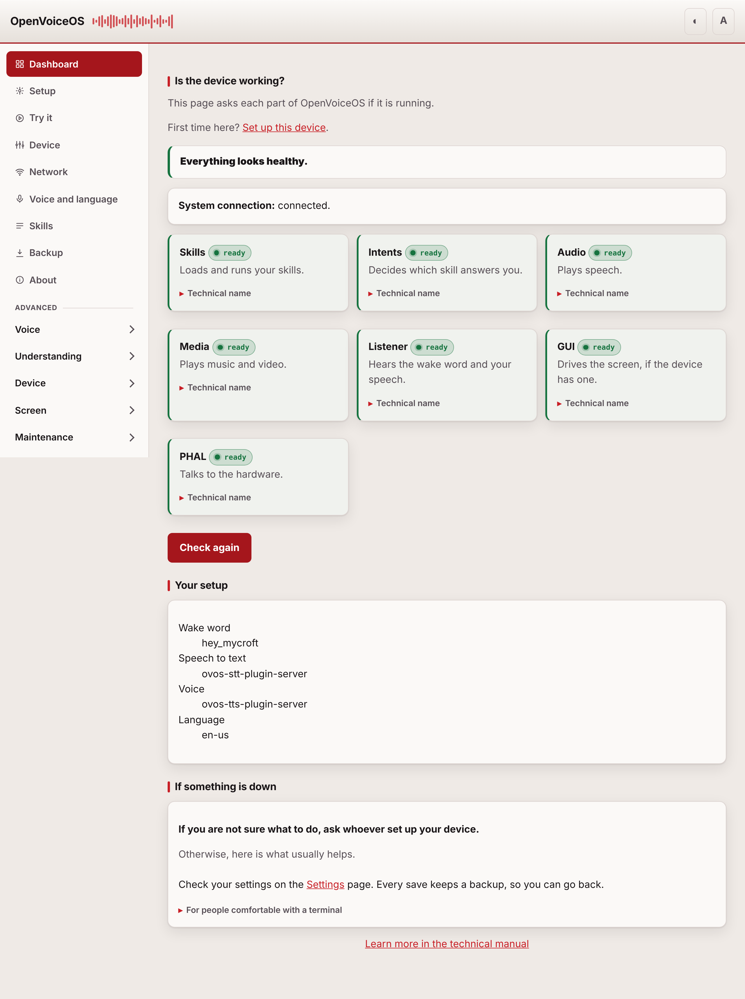
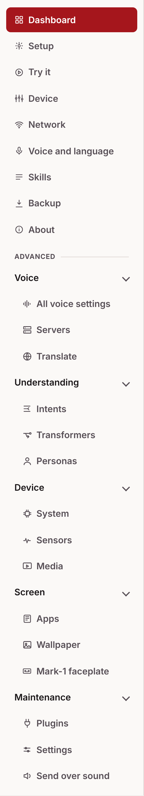

# ovos-control-panel documentation

## What is this?

ovos-control-panel is a web page that runs on your OpenVoiceOS device. You open it in
a browser on your phone or computer, on your own network. It shows you
whether the device works, lets you change its settings, and installs the
skills and plugins that give it its abilities and its voice. There is no
cloud, no account and no internet connection — every file the page needs is already on the device.

## Start here

New device, or never used this page before? Go to
**[Getting started](getting-started.md)** — it walks you through the first
few minutes, in order.

If something is not working, go straight to
**[Troubleshooting](troubleshooting.md)**.

## The menu

The menu is in two parts. The everyday pages are always there. Below them, under
**Advanced**, each group is a row that folds its pages open and shut. All groups
start folded, the panel remembers which ones you open, and the group of the page
you are on opens by itself.

A page that needs a plugin or hardware the device does not have leaves the menu,
and a group left empty goes with it. If you reach such a page anyway, it says
which package it needs and links to [Plugins](plugins.md). When the control
panel runs apart from the assistant, it cannot tell, so every page shows.

### Everyday

| Page | What it does | Docs |
| --- | --- | --- |
| Dashboard | Shows if the message bus and each OVOS service answer. | [dashboard.md](dashboard.md) |
| Setup | Walks a fresh device through language, plugins and a first question. | [setup.md](setup.md) |
| Try it | Sends a typed question through the device, the way a spoken one would go. | [tryit.md](tryit.md) |
| Device | Volume, microphone mute, restart and reboot. | [controls.md](controls.md) |
| Network | Whether the device is online, and the Wi-Fi networks near it. | [network.md](network.md) |
| Voice and language | The wake word, the voice and the language. | [voice-settings.md](voice-settings.md) |
| Skills | The skills on the device, their details and settings, and new ones to install. | [skills.md](skills.md) |
| Backup | Downloads a copy of your settings, and puts a copy back. | [backup-restore.md](backup-restore.md) |
| About | Shows the installed package versions and useful links. | [about.md](about.md) |

### Advanced

| Group | Page | What it does | Docs |
| --- | --- | --- | --- |
| Voice | All voice settings | Every voice setting: also listening, speech to text, the pipeline order and transformers. | [voice-settings.md](voice-settings.md) |
| | Servers | Points speech-to-text, text-to-speech, and translation at self-hosted servers, with failover. | [servers.md](servers.md) |
| | Translate | Translates what a skill says and hears into your language. | [translate.md](translate.md) |
| Understanding | Intents | Dry-runs a sentence, shows active skills, and browses every registered intent. | [intents.md](intents.md) |
| | Transformers | Turns transformer plugins on or off, orders them, and edits each plugin's settings. | [transformers.md](transformers.md) |
| | Personas | Makes and edits personas — the ordered list of solvers that answer you. | [personas.md](personas.md) |
| Device | System | SSH, the device location, and a factory reset. | [system.md](system.md) |
| | Sensors | Live readings from the device's sensors, if a sensor plugin is installed. | [sensors.md](sensors.md) |
| | Media | Shows what is playing and controls playback and volume. | [media.md](media.md) |
| Screen | Apps | Launches and closes desktop applications on a device with a screen. | [apps.md](apps.md) |
| | Wallpaper | Sets the background on a device with a screen, from a collection or by address. | [wallpaper.md](wallpaper.md) |
| | Mark-1 faceplate | Lights the Mark-1's eyes and puts text on its mouth; the editors come with the ovos-control-panel-mark1 extension. | [mark1.md](mark1.md) |
| Maintenance | Plugins | Finds OVOS plugins and installs or removes them; updates and the release channel. | [plugins.md](plugins.md), [updates.md](updates.md) |
| | Settings | Changes your layer of `mycroft.conf`, as a form or as raw JSON or YAML. | [configuration.md](configuration.md) |
| | Send over sound | Sends Wi-Fi credentials, installs, or commands to a nearby device by playing a sound. | [send-over-sound.md](send-over-sound.md) |

### Not in the menu

| Page | What it is | Docs |
| --- | --- | --- |
| Sign in | The page you see when a token is set. | [security.md](security.md) |
| Security | How the page protects your device, and what it does not protect against. | [security.md](security.md) |
| Accessibility | Keyboard and screen-reader support, and languages including right-to-left. | [accessibility.md](accessibility.md) |

## Common tasks

- **Set an access token** → [Getting started](getting-started.md)
- **The device isn't responding** → [Troubleshooting](troubleshooting.md)
- **Change the wake word, voice, or speech-to-text plugin** → [Voice and language](voice-settings.md)
- **Install a skill** → [Skills](skills.md)
- **Install a voice** → [Plugins](plugins.md)
- **Turn a skill off** → [Skills](skills.md)
- **Follow alpha releases** → [Updates](updates.md)
- **Make a backup before changing anything** → [Backup](backup-restore.md)
- **Use the device in another language** → [Accessibility and languages](accessibility.md)
- **Something behaves differently from the last stable release** → [Pre-release quirks](prerelease-quirks.md)
- **Reproduce a dependency set exactly** → [Constraints](constraints.md)

## For developers

| | Docs |
| --- | --- |
| Give your skill or plugin a page, from its settings up | [guide-pages.md](guide-pages.md) |
| Every block, field and rule of `controlpanel.json` | [controlpanel-json.md](controlpanel-json.md), [controlpanel.schema.json](controlpanel.schema.json) |
| Draw the same pages in Home Assistant, an app or another user interface | [for-other-uis.md](for-other-uis.md) |
| The panel's own Python pages, panel extensions, the menu, configuration and branding | [pages.md](pages.md) |
