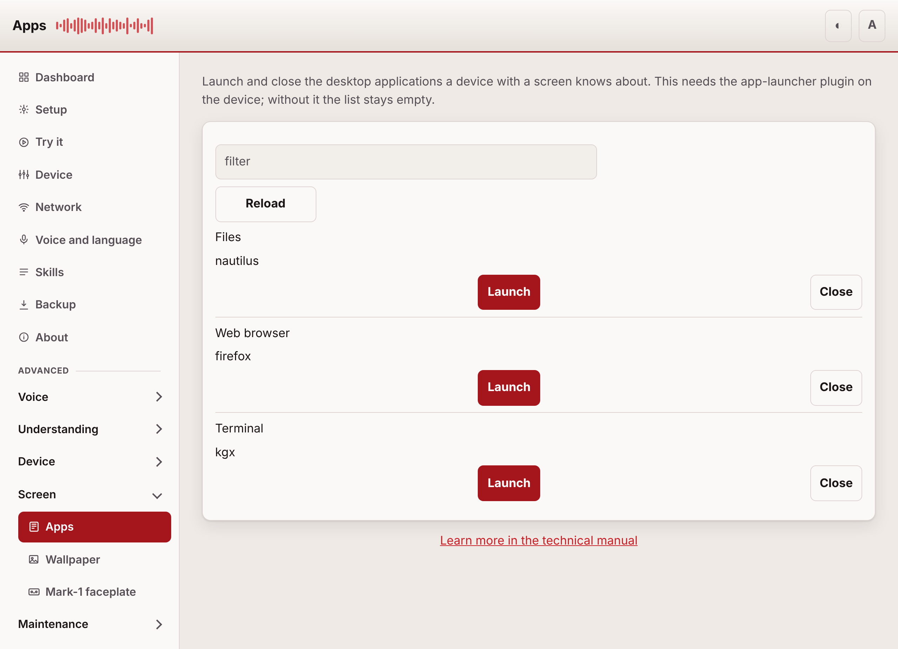
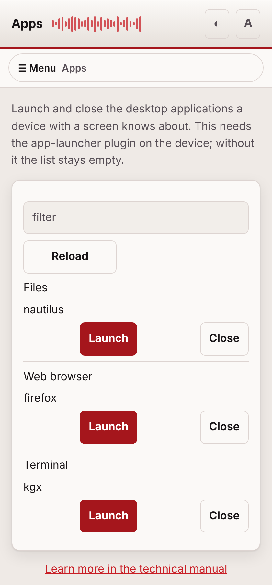

# Apps

The Apps page launches and closes the desktop applications a device with a
screen knows about. It talks to the app-launcher plugin on the device. A device
without that plugin has no Apps page.

## Launch or close an app

Each application in the list has a name and the command that runs it. Press
Launch to start it on the device's screen, or Close to stop it. The page
reports what happened, including the reason when an app does not start.

## This page needs a token to act

Anyone signed in can see the list, but launching and closing applications
changes what the device is doing, so those buttons need an access token, the
same as the other device pages. Set one on the
[Settings](configuration.md) page first.

## Where the page comes from

The page shows only where the app-launcher plugin is installed. The panel
brings it, described in `ovos_webui/bundled/ovos-phal-plugin-app-launcher/`,
until the plugin brings its own (see [Pages the panel brings](controlpanel-json.md#pages-the-panel-brings)).

---
[← Media](media.md) · [Home](README.md) · [Network →](network.md)
