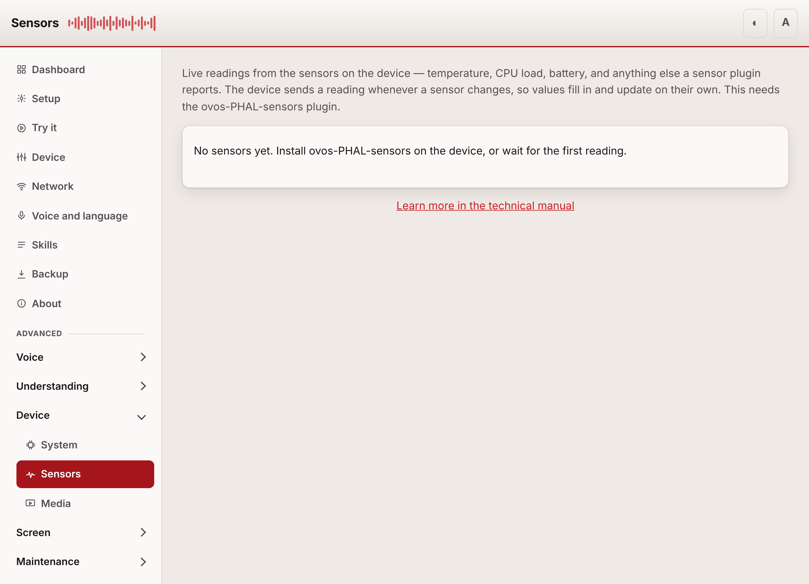
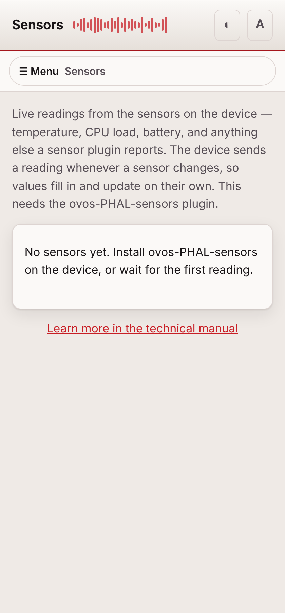

# Sensors

The Sensors page shows live readings from the sensors on the device —
temperature, CPU load, battery, and anything else a sensor plugin reports. It
needs the `ovos-PHAL-sensors` plugin. A device without it has no Sensors page.

## How it works

That plugin does not answer questions. Instead it sends out a reading every time
a sensor changes. So the panel listens for those readings and keeps the latest
value of each sensor, and the page refreshes on its own every few seconds. When
a sensor first reports, it appears in the list; after that its value updates in
place.

Readings shows each plain sensor's value and its unit, like `42 °C` or
`63 %`. On or off shows each on/off sensor, such as whether the device is
charging. The panel starts listening when the page is first opened, so a
sensor shows once it has reported after that.

## Where the page comes from

The panel brings this page, described in `ovos_webui/bundled/ovos-phal-sensors/`,
until the plugin brings its own (see [Pages](pages.md#pages-the-panel-describes)).

## Signing in

Being signed in is enough. Unlike installing or speaking, this page does not
need an access token, so it works on a device that has never been given one.

---
[← System](system.md) · [Home](README.md) · [Backup →](backup-restore.md)
