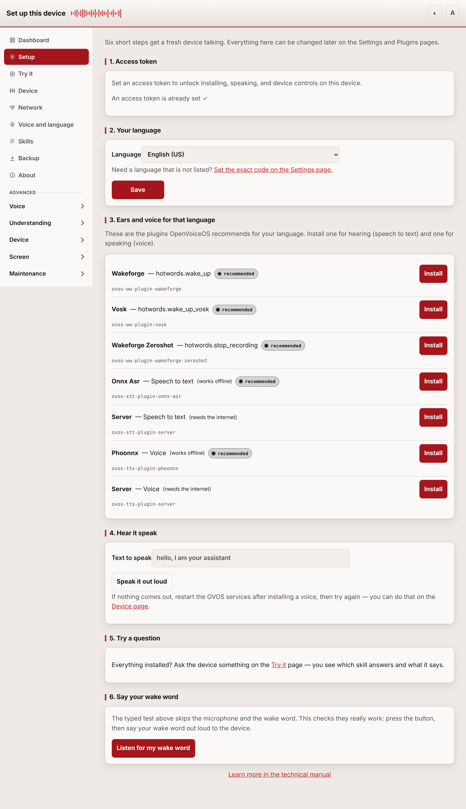
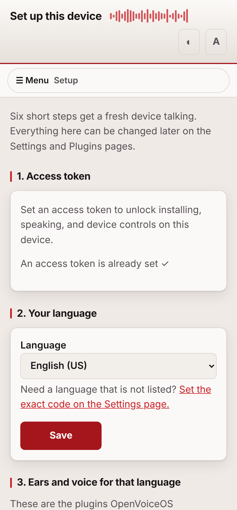

# Set up this device

This wizard gets a freshly-flashed device talking, in four steps: language,
hearing and voice plugins for that language, a sound check, then a first
question. Everything it touches can be changed later on the Settings and
Plugins pages, so you cannot get it wrong.





## How to get through it

1. **Language** writes `lang` into your configuration layer, and the plugin
   recommendations below it re-load for the new language.
2. **Ears and voice** lists the plugins OpenVoiceOS recommends for that
   language. Tap **Install** next to each one you need — this uses the same
   guarded installer as the Plugins page.
3. **Hear it speak** sends a `speak` message so you can confirm sound comes
   out of the device.
4. **Try a question** hands you over to the [Try it](tryit.md) page, where you
   can type a real question and see the device answer.

Installing plugins needs the access token, like every install — see
[security.md](security.md).

## A distribution's own guide

The steps above are the panel's own guide, for a device fresh from
ovos-installer, and without configuration that is what you get. A
distribution that knows its device better can choose its own guide in
`mycroft.conf`, in the system layer, like its [menu and its look](pages.md#configuration):

```json
{
  "webui": {
    "setup": {
      "steps": ["language", "voice", "house", "speak", "tryit"],
      "intro": "house.setup.intro"
    }
  }
}
```

- **The panel's own steps** are `token`, `language`, `voice`, `speak`,
  `tryit` and `wake`. Leave out the ones the device does not need (a device
  with no microphone has no wake word to test), in the order that suits it.
- **A described page as a step.** Any other id is a page described in a
  [`controlpanel.json`](guide-pages.md): its blocks are drawn in the guide,
  under the page's heading, and they talk to the skill or plugin exactly as
  on the page itself, with the same checks. A distribution's own step is
  then just a page it already has, such as a page for pairing the devices in
  the house, and no code of its runs in the panel.
- **`intro`** is a label from one of the pages' strings (or `{"key", "label"}`
  with its English text) for the line at the top. Without it the guide says
  that a few short steps get the device going. The steps are numbered in the
  order they come.

A step the panel cannot show (an id nobody knows, a page that is turned off,
one of the panel's Python pages) is left out, and the About page names it
with the other settings it could not use. If none of the steps can be shown,
the guide is the panel's own. The steps are also served at
`/api/setup/guide`, so [another user interface](for-other-uis.md) can follow
the same guide.

## If it doesn't work

If a plugin fails to install or the device stays silent, see
[troubleshooting.md](troubleshooting.md).

---
[← Dashboard](dashboard.md) · [Home](README.md) · [Settings →](configuration.md)
