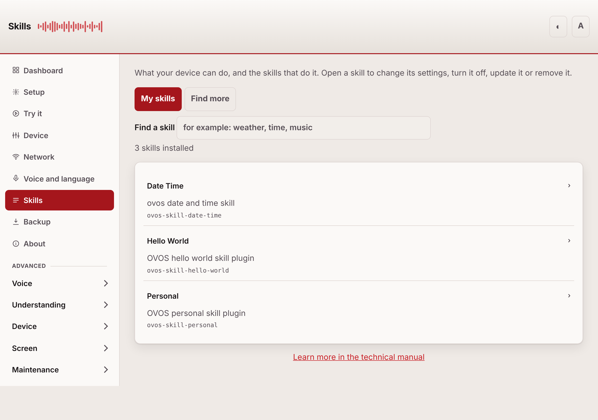
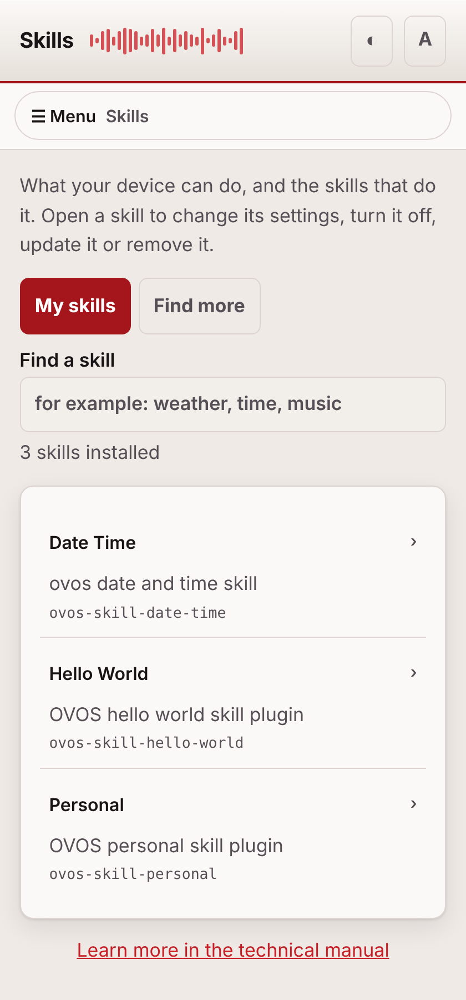
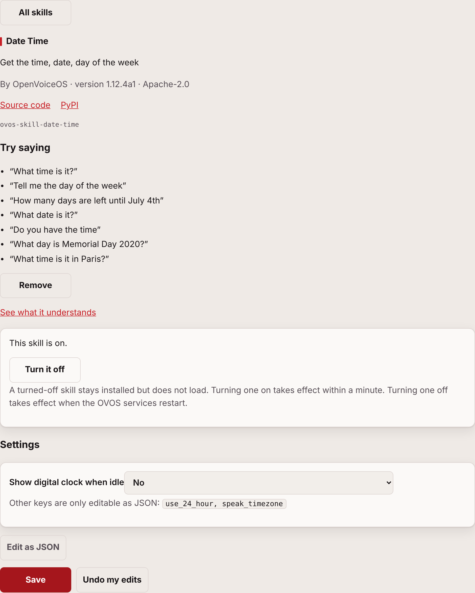

# Skills

Skills are what the device can do: tell the time, answer a question, play
music. The Skills page lists the skills on the device, opens one to show what
it does and to change it, and finds new ones to install.





## Common tasks

- **Find out what the device can do**: open **My skills** and scroll, or type
  in the filter.
- **Change how a skill behaves**: open the skill and fill in its settings.
- **Turn a skill off without removing it**: open the skill and press
  **Turn it off**.
- **Install a new skill**: open **Find more**, search, open the result and
  press **Install**.
- **Update or remove a skill**: open the skill and press **Update** or
  **Remove**. A skill with a newer version says so in the list.

## My skills

The list shows every skill installed on the device, with its name, its icon if
it has one, and the one-line description from the skill itself. A badge marks a
skill that is turned off or has an update. The filter finds a skill by name or
by a word in its description.

The list comes from the packages installed on the device and the skill settings
directory. It needs no network.

## A skill, opened

Press a skill to open it. The page shows:




- the name, the icon and the description
- the author, the version, and links to the source code and to PyPI
- **Try saying**: example sentences the skill answers, in the device's
  language when the skill has them
- **Update**, **Remove**, and **See what it understands**, which opens the
  skill's intents on the [Intents](intents.md) page
- whether the skill is on, with a button to turn it off or back on
- its settings, if it has any

The description, author, icon and examples come from the skill's own
`skill.json` and from its package on PyPI. A skill that ships neither shows what
it can.

**All skills** goes back to the list. The address of an opened skill can be
bookmarked: `/skills#<skill id>` opens that skill directly.

## Find more

**Find more** searches PyPI for skills that load in OpenVoiceOS. Type a name or
a word, such as `weather` or `home assistant`, and press **Search**. A result
that is already installed says so. Open a result to see the same details as an
installed skill before you install it.

PyPI has many packages named `skill-something` that have nothing to do with
OpenVoiceOS. The page leaves out any package that registers no skill and
depends on no OpenVoiceOS package, so those are never offered. `/skills#find`
opens this tab directly.

Installing a skill changes the software on the device, so it **always needs a
token**. See [security.md](security.md). The skills service rescans about every
thirty seconds and loads a newly installed skill on its own.

## Before an install

When the control panel runs next to the assistant, it first asks pip what the
install would do, without doing it. If the install would downgrade an
OpenVoiceOS package that is already on the device, or would fail, the page
lists that and asks before it goes ahead. This applies to plugins too. See
[plugins.md](plugins.md).

## Settings

A skill keeps its settings in:

```
<XDG config>/<base>/skills/<skill id>/settings.json
```

This is the same path that `ovos-workshop` uses, so a change here is what the
skill reads.

A skill can ship a `settingsmeta.json` or a `settingsmeta.yaml` that describes
its fields. When it does, the page shows a form with a label for each field.
When it does not, the page builds a form from the values already in
`settings.json`, with `ovos_workshop.settings.settings2meta`, and says so.

A key that the form does not cover stays in the file. The page names those keys,
and you can edit them with **Edit as JSON**. Keys that start with an underscore
are internal, and the page leaves them alone.

Every save first copies the old `settings.json` into a `.ovos-webui-backups`
directory beside it. The last 20 copies are kept.

The skill id in the address is checked before it reaches the file system. It
must be a plain name: letters, digits, dot, dash and underscore. A name with a
slash, a parent reference, a null byte or a leading dot is refused. The path
that comes out of the check is then checked again against the skills directory.

## Turning a skill off

Off means the skill id is added to `skills.blacklisted_skills` in your
configuration layer: the skill stays installed and keeps its settings, it just
does not load.

Turning a skill on takes effect on its own: the skills service re-reads the
list about every thirty seconds and loads anything no longer blocked. Turning
one off only stops it loading next time, because nothing unloads a skill that
is already running, so it keeps answering until the OVOS services restart. The
page says which of the two happened.

## The old Abilities page

The Abilities page is now part of this page. `/abilities` takes you here.

## If it doesn't work

If a skill you installed is missing from the list, give the skills service half
a minute, then check the [Dashboard](dashboard.md). If Find more finds nothing,
the device may not reach PyPI. For anything else, see
[troubleshooting.md](troubleshooting.md).

---
[← Voice and language](voice-settings.md) · [Home](README.md) · [Intents →](intents.md)
