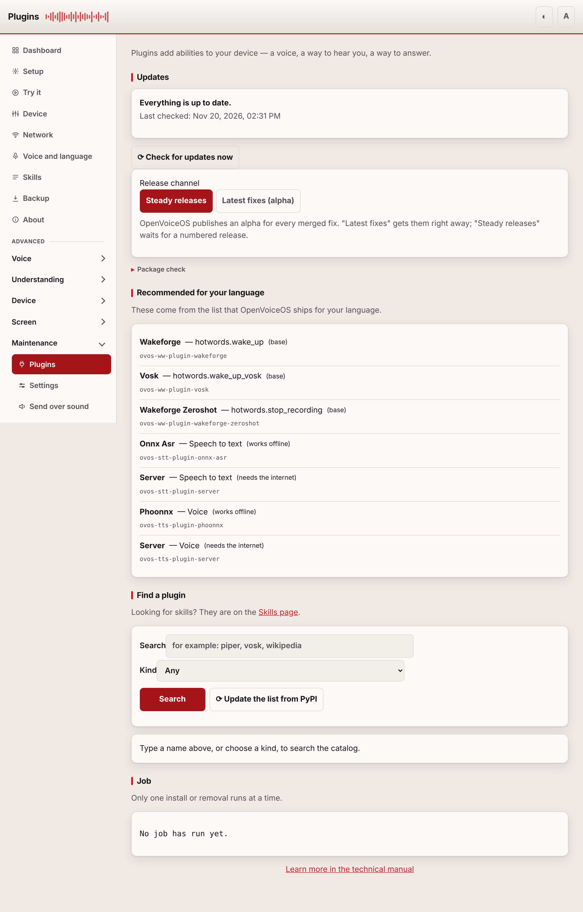

# Updates, release channel and dependency health

The Plugins page carries three related tools.

## Updates

The service compares every installed `ovos-*` package with PyPI and lists the
ones that are behind, with an Upgrade button each. Upgrades go over the bus to
the device's installer service, the same as installs: one job at a time, output
streamed to the page, token always required. Version answers are cached for
six hours. An unreachable PyPI never blocks the page.

## Release channel

OpenVoiceOS publishes an alpha release for every merged fix.

- **Steady releases** (default): pip only moves between numbered releases.
- **Latest fixes (alpha)**: the newest alpha is eligible for installs and
  upgrades.

The choice is stored as `webui.release_channel` in your configuration layer.
Changing it needs the token, because it changes what future installs do.

The device's own installer has to follow the same channel, or an install pulls
the wrong versions: on an alpha device, an install against the stable
constraints file moves OpenVoiceOS packages back to their stable releases. So
choosing a channel also sets the installer, in the same save:

- `skills.installer.constraints` to the channel's constraints file from
  [ovos-releases](https://github.com/OpenVoiceOS/ovos-releases)
  (`constraints-stable.txt` or `constraints-alpha.txt`)
- `skills.installer.allow_alphas` to whether the channel is alpha

A constraints file chosen by hand, such as the testing file or a file on the
device, is left alone, and the page shows which file is used. When the
installer does not follow the chosen channel, for example on a device set up by
hand, the page says so and offers **Make installs follow this channel**.

The installer services read this setting when they start, so after a change
the page offers to restart the voice services.

## Dependency health

"Dependency health" runs `pip check`, a constant argument vector with no
request data in it, and shows what pip reports. A conflict usually clears
after upgrading the named packages.

---
[← Accessibility](accessibility.md) · [Home](README.md)
